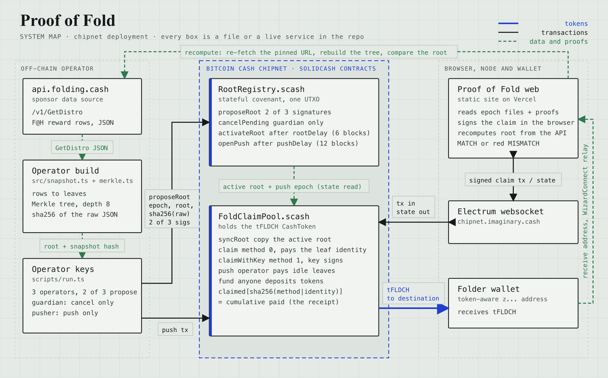
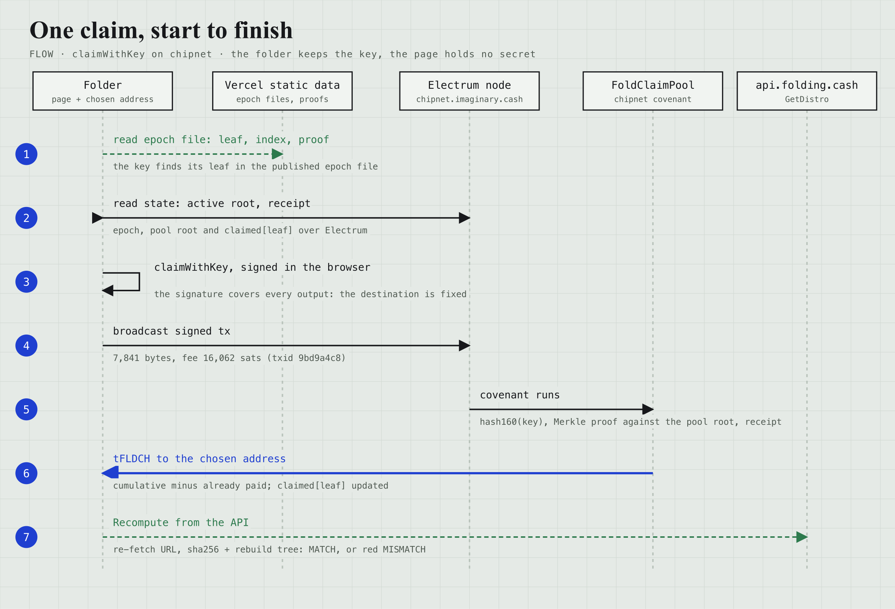

# Proof of Fold





Pull-based FoldingCash rewards, written in SolidCash. A folder claims their own tFLDCH with a Merkle proof and the key behind their existing address. The operator publishes one root per epoch instead of one payment per folder.

Proof of Fold builds its payout leaves from the live sponsor API (`api.folding.cash/v1/GetDistro`), pins the SHA-256 of the raw response next to the root on chain, and lets anyone re-fetch the URL, rebuild the tree and compare. The 56 rows of the pinned window are all legacy `1...` addresses; Proof of Fold pays them without any address-linking database, because the folder's key signs the claim.

## Live on chipnet

| What | Value |
|---|---|
| Token | `a1072ff78525d5e612e64905dc320533308397518fb3226692d36745e7ab3471` (tFLDCH, 8 decimals) |
| RootRegistry | `bchtest:pdxa23mu3k5tpwd6228ajg7zuhsswq27u5ntwdh59cfs8kgx7ytkc45fuvxwz` , category `f3d1b771511b07efa982513fa65f3dd02465c81a4f4b3d9f9fba01f4e001d56b` |
| FoldClaimPool | `bchtest:pdx85dqzxjlqjg47se7grq7lmtpanfzfuwpehfc5akpsuys9uelju4ttx8vxv` , category `fab5154f9ab557ab05ae183e479c56124033e57f6b8af244bfc019673b676fda` |
| Windows | audit 6 and push 12 (constructor arguments; the contract measures them with the chain's relative timelock) |
| Epoch 1 root | `a890b9cc68b773c429b13654bcc39771d017eac75a1ac22d17b6f9420eb697f8` over 206 leaves, depth 8 |
| Snapshot | `https://api.folding.cash/v1/GetDistro?startDate=11-01-2026&endDate=11-20-2026&amount=1000000`, SHA-256 `d13b3ec2f81cd10e1ccf9308966821f9b72cf108cc1271765f514364d47fb4ab` |

| Step | Transaction |
|---|---|
| Registry genesis | [`5ce909bb6c8c91bdcb4107a5cbfb64a4e47ab8c99845a4e192bcb1508d2004f1`](https://chipnet.imaginary.cash/tx/5ce909bb6c8c91bdcb4107a5cbfb64a4e47ab8c99845a4e192bcb1508d2004f1) |
| Pool genesis | [`51602319eeb32387bbbf65b5c8ef7178590ebe9a939441171fd08a9ff66eb8dd`](https://chipnet.imaginary.cash/tx/51602319eeb32387bbbf65b5c8ef7178590ebe9a939441171fd08a9ff66eb8dd) |
| Pool funded | [`04f4cbcbdee053014e871ef70ec468d05ed7e0692a6fdffc3c0791da8170dc86`](https://chipnet.imaginary.cash/tx/04f4cbcbdee053014e871ef70ec468d05ed7e0692a6fdffc3c0791da8170dc86) |
| Epoch 1 proposed by two operators | [`d51db6e2b8788a73e7be747fab4354c14cd786f7f70e1e9ba687a94f1151ee27`](https://chipnet.imaginary.cash/tx/d51db6e2b8788a73e7be747fab4354c14cd786f7f70e1e9ba687a94f1151ee27) |
| Epoch 1 activated after the audit window | [`d1ae9eef08f4d2d32dfc73c6c3a5b70f1ad5116576ade59de4c29e33dfbeb209`](https://chipnet.imaginary.cash/tx/d1ae9eef08f4d2d32dfc73c6c3a5b70f1ad5116576ade59de4c29e33dfbeb209) |
| Epoch 2 proposed | [`25939f03c701e1dfbcd0dab9c2af7cf07091f7fbeea595c614629797d2ad462f`](https://chipnet.imaginary.cash/tx/25939f03c701e1dfbcd0dab9c2af7cf07091f7fbeea595c614629797d2ad462f) |
| Epoch 2 cancelled by the guardian | [`28e744293a1832840df9b9faff4354b123ef96e778a8b352352e0fe361a888fa`](https://chipnet.imaginary.cash/tx/28e744293a1832840df9b9faff4354b123ef96e778a8b352352e0fe361a888fa) |
| Epoch 3 proposed | [`b738b6f492f9ba4efd598da880b11efeeaa966897c0006a7f7063e85ad11c4a4`](https://chipnet.imaginary.cash/tx/b738b6f492f9ba4efd598da880b11efeeaa966897c0006a7f7063e85ad11c4a4) |
| Epoch 3 activated | [`5c4631caa3934ef936f36d6a6c9bd0594f73cb57b109003559181ef7738e1e71`](https://chipnet.imaginary.cash/tx/5c4631caa3934ef936f36d6a6c9bd0594f73cb57b109003559181ef7738e1e71) |
| Pool synced to epoch 3 | [`c69134a64ee6fab12087d2ade3c75a19540245dfda3d555c94f14cddd38fd681`](https://chipnet.imaginary.cash/tx/c69134a64ee6fab12087d2ade3c75a19540245dfda3d555c94f14cddd38fd681) |
| Claim from the command line, demo claimer 149 | [`c7c18baa215d9ca0bac83e70ffeb996be755c67102259a0a9a2cb6cab688a573`](https://chipnet.imaginary.cash/tx/c7c18baa215d9ca0bac83e70ffeb996be755c67102259a0a9a2cb6cab688a573) |
| Claim from the browser | [`9bd9a4c80149da766cd6090eeb7bfc90739f32479e9cbbc9ccf0303071ac160d`](https://chipnet.imaginary.cash/tx/9bd9a4c80149da766cd6090eeb7bfc90739f32479e9cbbc9ccf0303071ac160d) |
| Epoch 4 proposed | [`02c7700af0290defca363863a7c1543add159fe726bc19a70107fe1d407b3446`](https://chipnet.imaginary.cash/tx/02c7700af0290defca363863a7c1543add159fe726bc19a70107fe1d407b3446) |
| Epoch 4 activated | [`b4338097a252c35c0445805f2ed8a48b3ee51f76a0a6213275e5e5a5a32bda2e`](https://chipnet.imaginary.cash/tx/b4338097a252c35c0445805f2ed8a48b3ee51f76a0a6213275e5e5a5a32bda2e) |
| Pool synced to epoch 4 | [`b3be6e163be3feadf86edef44119ea2b5907164a74e50d43371831c792354e2c`](https://chipnet.imaginary.cash/tx/b3be6e163be3feadf86edef44119ea2b5907164a74e50d43371831c792354e2c) |
| Epoch 4 claim, only the difference | [`af5e326aef8566332f7e01565e47e7ce65cca9dcc8f6d0332df8394584394c37`](https://chipnet.imaginary.cash/tx/af5e326aef8566332f7e01565e47e7ce65cca9dcc8f6d0332df8394584394c37) |
| Registry opens the push window | [`d0d38fa875dac24ce88663473a634963f9e36cce6b31cc756152f9ed35790160`](https://chipnet.imaginary.cash/tx/d0d38fa875dac24ce88663473a634963f9e36cce6b31cc756152f9ed35790160) |
| Operator push | [`9a137d4c144799568b830ece32527e25e539a898d805bc7f251a3df81f4f4ed0`](https://chipnet.imaginary.cash/tx/9a137d4c144799568b830ece32527e25e539a898d805bc7f251a3df81f4f4ed0) |

Every transaction can be read back with `npx tsx scripts/tx.ts chipnet <txid>`.

## A judge's first minute

Open the page, paste any token-aware address, press **Claim**. The browser signs with a published demo key, pays the fee from that key's float and broadcasts over a public Electrum socket. The tokens land in the judge's own wallet. No relayer, no per-IP cap, no server. Then press **Recompute from the API**: the page re-fetches the pinned URL, rebuilds the tree, and shows MATCH against the root on chain; a second button flips one digit of the snapshot and shows the red MISMATCH.

## How a claim works

Leaf: `sha256(0x00 | method | identity | cumulative as 8 bytes)`. Node: `sha256(0x01 | left | right)`. `cumulative` is the total earned since the first epoch, so a claim pays `cumulative - already` and a folder can skip epochs.

| Method | Identity | Who submits | Where the tokens go |
|---|---|---|---|
| 0 | locking bytecode of a BCH or token-aware address | anyone | exactly that locking bytecode |
| 1 | hash160 of a public key (the legacy `1...` address) | anyone who holds the key | the destination the key owner chose; the signature covers every output |

The receipt is a SolidCash verified mapping `claimed[sha256(method | identity)]`: one entry per leaf holding the cumulative total already paid. Double claims fail in the covenant (`NothingToClaim`), a relayer cannot redirect a method 1 payout, and a forged leaf, index, proof, token or receipt key fails `BadProof`, `WrongToken` or the receipt check.

## Root authority

- Two of three operator keys propose a root together with the SHA-256 of the exact API response it was built from (`contracts/RootRegistry.scash:46`).
- The proposal waits `rootDelay` of relative time on the registry's own UTXO (`contracts/RootRegistry.scash:65`). The chain enforces the lock, so no key can shorten it.
- A separate guardian key can cancel a pending root during the window and can never propose (`contracts/RootRegistry.scash:57`). Cancelled epochs are burned.
- While a proposal is pending no second one is accepted, so the operator cannot restart the window.
- Activation is permissionless (`contracts/RootRegistry.scash:63`). The pool copies only the active root (`contracts/FoldClaimPool.scash:52`).

## Operator push

After the registry has held an active root idle for `pushDelay` (`contracts/RootRegistry.scash:73`), the operator may pay leaves that never claimed, only to the leaf's own identity and only for payouts of at least 1,000 base units (`contracts/FoldClaimPool.scash:114`). A pushed leaf is settled in the same receipt, so the owner cannot be paid twice.

## Cost

Measured claim size under production limits, by proof depth (real accepted claims, `docs/depth-analysis.json`): depth 1 7,605 B, depth 4 7,702 B, depth 8 7,831 B, depth 9 7,863 B, depth 12 7,959 B, depth 16 8,087 B, depth 20 8,215 B, depth 24 8,343 B. A 256 leaf tree claims in 7,831 bytes. The folder pays that fee when they claim; the operator signs one proposal per epoch (about 4.7 kB) whatever the number of folders; activation and the pool sync are permissionless, so any party can pay for them. Pushing one payment per folder costs the operator at least 148 + 34 bytes per folder per epoch plus dust, so one proposal is cheaper from 26 folders upward. Measured on chipnet: a claim is 7,847 bytes and paid 16,074 sats at 2.05 sat/byte; a proposal is 4,706 bytes (9,792 sats), an activation 4,859 bytes, a sync 6,372 bytes. The page prints the figures read from the transactions above.

## SolidCash features

| Feature | Where |
|---|---|
| Stateful contracts, constructor arguments | `contracts/RootRegistry.scash:23`, `contracts/FoldClaimPool.scash:34` |
| Verified mapping | `contracts/FoldClaimPool.scash:42` |
| Token container: deposit, transfer | `contracts/FoldClaimPool.scash:45`, `contracts/FoldClaimPool.scash:98` |
| Cross-contract state read through an interface | `contracts/FoldClaimPool.scash:3`, `contracts/FoldClaimPool.scash:52` |
| Relative timelock (`this.age`) | `contracts/RootRegistry.scash:65`, `contracts/RootRegistry.scash:76` |
| `checkMultiSig` and `checkSig` | `contracts/RootRegistry.scash:37`, `contracts/FoldClaimPool.scash:105` |
| Modifiers | `contracts/RootRegistry.scash:36`, `contracts/RootRegistry.scash:41` |
| Enum | `contracts/RootRegistry.scash:13` |
| Events, read back in tests | `contracts/RootRegistry.scash:3`, `contracts/FoldClaimPool.scash:15` |
| Custom errors | `contracts/RootRegistry.scash:8`, `contracts/FoldClaimPool.scash:20` |
| Internal functions, loops | `contracts/FoldClaimPool.scash:61`, `contracts/FoldClaimPool.scash:83`, `contracts/FoldClaimPool.scash:67` |
| Constants | `contracts/FoldClaimPool.scash:35` |
| Locking bytecode construction | `contracts/FoldClaimPool.scash:124` |

## Tests

51 of 51 SolidHat tests pass on a mock network that enforces the BCH production limits (10,000 byte inputs, 100,000 byte transactions, dust and relay rules). 19 of 19 guard mutations are killed: break the guard, the named test turns red, restore it, green. See TESTS.md.

## Run it

```bash
npm install
npx solidhat test                      # contracts, claims, forged claims, depth, snapshot
npx tsx scripts/run.ts <net> status    # read the live registry and pool
npm run web:build                      # static site in web/dist
```

Layout: `contracts/` (SolidCash), `src/` (Merkle tree, snapshot builder, pool client), `scripts/` (chain driver, faucet, mutation harness), `test/`, `web/`, `docs/RUNBOOK.md`, `upstream/`.

## Sponsor questions, answered on chain

| Question | Answer |
|---|---|
| Root cadence | One root per epoch; leaves are cumulative so any cadence works and folders skip epochs |
| Maximum leaves | Proof depth up to 24 (16.7 million leaves); the claim grows by 32 bytes per level (docs/depth-analysis.json) |
| Root authority | 2 of 3 operators propose, a guardian can cancel, activation is permissionless |
| Receipt layout | Verified mapping keyed by `sha256(method | identity)`, value is the cumulative total paid |
| Leaf contents | method byte, identity, cumulative amount |
| Link method and verification | Method 1: the signature of the key behind the legacy address; the contract checks `hash160(pubkey)` against the leaf and `checkSig` over the whole transaction |

## Upstream

Four pull-request packages for solidcash/solidcash are prepared in `upstream/`, each with a failing-then-passing test: the libauth git dependency that blocks `npm install` under `allow-git=none`, a Merkle pull-claim example with a showcase entry, tests for the stateful `this.age` sequence, and a fix for external state reads that pick a relocated data NFT by output order instead of its index tag. See `upstream/README.md`.
