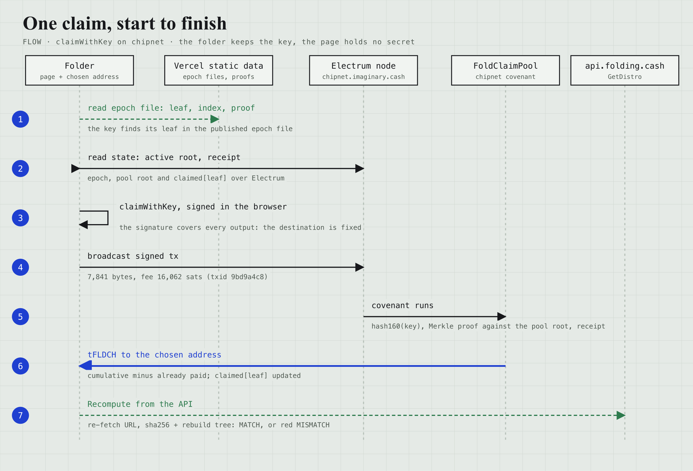
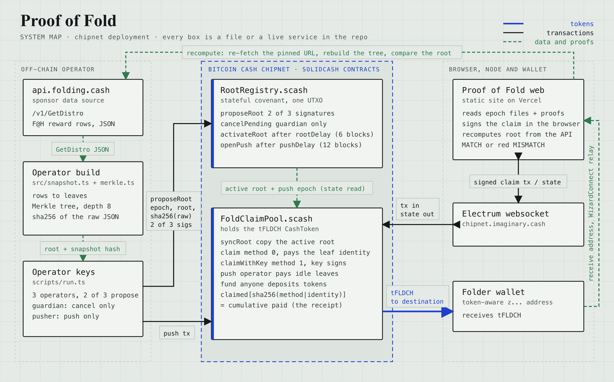

# Proof of Fold

**Folders claim their own FoldingCash rewards with a single Merkle proof.**

Proof of Fold is a pull-based reward pool for FoldingCash, written in SolidCash. A folder signs one claim with the key behind their existing `1...` address and the pool covenant pays out tFLDCH; the operator publishes one Merkle root per epoch instead of one payment per folder, and every root is built from the live `api.folding.cash/v1/GetDistro` response.

## How it works

A leaf is `sha256(0x00 | method | identity | cumulative as 8 bytes)`. Because `cumulative` is the total earned since the first epoch, a claim pays `cumulative - already`, and a folder can skip epochs without losing anything. Method 1 binds the leaf to the hash160 of a public key, so the 56 legacy `1...` rows of the pinned API window are paid with no address-linking database: the signature on the claim is the link, and it covers every output, so a relayer cannot redirect the payout.

The receipt is a SolidCash verified mapping, `claimed[sha256(method | identity)]`, holding the cumulative total already paid. A second claim of the same total reverts with `NothingToClaim`. A forged leaf, index, proof or token fails `BadProof` or `WrongToken`.

Root authority sits in a separate contract. Two of three operator keys propose a root together with the SHA-256 of the exact API response it came from. The chain enforces an audit window with a relative timelock on the registry's own UTXO, so no key can shorten it, and a guardian key can cancel a pending root but can never propose one. Anyone may activate a root once the window closes, and the pool copies only the active root.

## Architecture

Two SolidCash covenants hold all the rules: `RootRegistry` (root proposals, veto, timelocks) and `FoldClaimPool` (claims, receipts, operator push). The web client is a static Vercel site that reads state and broadcasts over a public Electrum websocket on chipnet, so there is no relayer and no server holding a key. The same page re-fetches the pinned API URL and rebuilds the tree, so anyone can check the root on chain against the sponsor's data.

## Proof

Everything below is on chipnet. The numbers come from `TESTS.md`, `docs/` and the transaction read-back in `deployments/chipnet/tx-facts.json`.

**Tests.** 51 of 51 SolidHat tests pass on a mock network that enforces BCH production limits (10,000 byte inputs, 100,000 byte transactions, 128 byte commitments, dust and relay rules).

| File | Tests | Covers |
|---|---|---|
| test/registry.test.ts | 13 | 2-of-3 proposals, audit window, guardian veto, push window |
| test/pool.test.ts | 17 | method 0 and 1 claims, 10 forged-claim shapes, key theft, replay, operator push gates |
| test/merkle.test.ts | 7 | tree, proofs, tamper, duplicates, little endian amounts |
| test/snapshot.test.ts | 6 | GetDistro parsing, exact decimal amounts, legacy address to hash160 |
| test/depth.test.ts | 8 | real claims at proof depth 1 to 24 under production limits |

19 of 19 guard mutations are killed: each one breaks a guard in the contract source, the named test turns red, the source is restored and the same test turns green. A claim measures 7,605 bytes at proof depth 1 and 8,343 bytes at depth 24 (up to 16,777,216 leaves).

**Transactions on chipnet.** Token `a1072ff78525d5e612e64905dc320533308397518fb3226692d36745e7ab3471` (tFLDCH, 8 decimals).

| Step | Txid | Bytes | Fee (sats) | Block |
|---|---|---|---|---|
| Registry genesis | [`5ce909bb...2004f1`](https://chipnet.imaginary.cash/tx/5ce909bb6c8c91bdcb4107a5cbfb64a4e47ab8c99845a4e192bcb1508d2004f1) | 898 | 1,898 | 341325 |
| Pool genesis | [`51602319...6eb8dd`](https://chipnet.imaginary.cash/tx/51602319eeb32387bbbf65b5c8ef7178590ebe9a939441171fd08a9ff66eb8dd) | 842 | 1,842 | 341471 |
| Pool funded | [`04f4cbcb...70dc86`](https://chipnet.imaginary.cash/tx/04f4cbcbdee053014e871ef70ec468d05ed7e0692a6fdffc3c0791da8170dc86) | 5,953 | 12,286 | 341474 |
| Epoch 1 proposed by two operators | [`d51db6e2...51ee27`](https://chipnet.imaginary.cash/tx/d51db6e2b8788a73e7be747fab4354c14cd786f7f70e1e9ba687a94f1151ee27) | 4,706 | 9,792 | 341327 |
| Epoch 1 activated after the audit window | [`d1ae9eef...beb209`](https://chipnet.imaginary.cash/tx/d1ae9eef08f4d2d32dfc73c6c3a5b70f1ad5116576ade59de4c29e33dfbeb209) | 4,859 | 10,098 | 341389 |
| Epoch 2 cancelled by the guardian | [`28e74429...a888fa`](https://chipnet.imaginary.cash/tx/28e744293a1832840df9b9faff4354b123ef96e778a8b352352e0fe361a888fa) | 4,097 | 8,574 | 341418 |
| Claim from the command line, demo claimer 149 | [`c7c18baa...88a573`](https://chipnet.imaginary.cash/tx/c7c18baa215d9ca0bac83e70ffeb996be755c67102259a0a9a2cb6cab688a573) | 7,841 | 16,062 | 341495 |
| Claim from the browser | [`9bd9a4c8...ac160d`](https://chipnet.imaginary.cash/tx/9bd9a4c80149da766cd6090eeb7bfc90739f32479e9cbbc9ccf0303071ac160d) | 7,841 | 16,062 | 341501 |
| Epoch 4 claim, only the difference | [`af5e326a...394c37`](https://chipnet.imaginary.cash/tx/af5e326aef8566332f7e01565e47e7ce65cca9dcc8f6d0332df8394584394c37) | 7,455 | 15,264 | 341559 |
| Operator push | [`9a137d4c...4f4ed0`](https://chipnet.imaginary.cash/tx/9a137d4c144799568b830ece32527e25e539a898d805bc7f251a3df81f4f4ed0) | 7,746 | 15,872 | 341964 |

Epoch 1 root `a890b9cc68b773c429b13654bcc39771d017eac75a1ac22d17b6f9420eb697f8` covers 206 leaves at depth 8, built from `https://api.folding.cash/v1/GetDistro?startDate=11-01-2026&endDate=11-20-2026&amount=1000000` (SHA-256 `d13b3ec2f81cd10e1ccf9308966821f9b72cf108cc1271765f514364d47fb4ab`).

## What a judge can try in 60 seconds

1. Open [proof-of-fold.vercel.app](https://proof-of-fold.vercel.app). The state strip fills with the chipnet block height, the active epoch root and the pool balance, all read over Electrum.
2. Paste any token-aware chipnet address (it starts with `bchtest:z`) or press **Connect with WizardConnect**, then press **Claim**. The browser signs with a published demo key, broadcasts, and shows the txid, size, fee and receipt. Press **Submit the same claim again** to watch the covenant refuse it.
3. Press **Recompute from the API**. The page re-fetches the pinned URL, rebuilds the tree and shows MATCH against the root on chain. **Load a tampered copy** flips one digit and shows the red MISMATCH.

## Bounties

**FoldingCash Reward Claims.** Reward data comes from the live `api.folding.cash` GetDistro endpoint, not a fixture: `src/snapshot.ts` parses the rows into leaves, and the SHA-256 of the raw response is pinned next to each root on chain. The sponsor's open questions have on-chain answers: any root cadence works because leaves are cumulative, proof depth goes to 24, root authority is 2 of 3 with a guardian veto, and linking a legacy address to a BCH payout is the key signature itself.

**Best SolidCash Application.** The contracts are `contracts/RootRegistry.scash` and `contracts/FoldClaimPool.scash`, tested with SolidHat. They use stateful contracts with constructor arguments, a verified mapping, the token container (deposit and transfer), a cross-contract state read through an interface, a relative timelock (`this.age`), `checkMultiSig` and `checkSig`, modifiers, an enum, events read back in tests, custom errors, internal functions with loops, constants and locking bytecode construction. Four pull-request packages for solidcash/solidcash sit in `upstream/`, each with a failing-then-passing test: the libauth git dependency, a Merkle pull-claim example, tests for the stateful `this.age` sequence, and a fix for external state reads of a relocated data NFT.

## Built with

- SolidCash 0.50.0 (`.scash` contracts, `@solidcash/solidc`, `@solidcash/solidcash`)
- SolidHat for the contract test suite and mock network
- CashTokens on Bitcoin Cash chipnet
- libauth for transaction and address handling
- WizardConnect for wallet pairing
- Electrum websocket (chipnet.imaginary.cash)
- TypeScript, Vite, Vitest
- Vercel for the static demo

## Links

- Live demo: https://proof-of-fold.vercel.app
- Deck: https://proof-of-fold.vercel.app/deck/
- Repo: https://github.com/kamalbuilds/proof-of-fold
